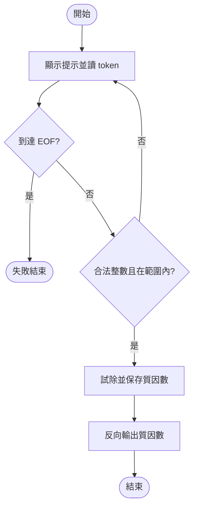

# 2021 期中考：重寫題目、解法與程式

## 資料範圍

依考後回憶整理。原檔有重複題號、缺程式附件和未完整記錄的選項，因此以下依主題重新编号；「補定練習」表示本解答新增的明確規格，不能視為原試卷逐字內容。程式採 C++11。

## 1. 連接邊中點的正方形

**重寫題目：** 第一個正方形面積為 1024 mm²，每次連接前一個正方形四邊的中點，形成新的正方形。定義遞迴關係，輸出第 1 至 10 個面積，並追蹤第 4 個面積的呼叫堆疊。

四個角落三角形合計占原面積一半，所以 `A(1)=1024`，`A(n)=A(n-1)/2`。本題前十項都是整數：1024、512、256、128、64、32、16、8、4、2。遞迴時間與深度都是 O(n)。

`area(4)` 的有效堆疊依序為下表。最底層呼叫者和 `main` 的實際配置取決於作業系統與編譯器；這是語意上的呼叫紀錄，不假稱固定 ABI、記憶體位置或固定九個實體框架。

| 時點 | 尚未返回的呼叫（由底至頂） | 新產生的返回值 |
|---|---|---|
| 進入 | main → area(4) | — |
| 遞迴一層 | main → area(4) → area(3) | — |
| 遞迴兩層 | main → area(4) → area(3) → area(2) | — |
| 到達基底 | main → area(4) → area(3) → area(2) → area(1) | 1024 |
| 返回一層 | main → area(4) → area(3) → area(2) | 512 |
| 返回兩層 | main → area(4) → area(3) | 256 |
| 返回三層 | main → area(4) | 128 |
| 全部返回 | main | 128 已交給呼叫者 |

`stack` 模式逐層顯示進入與返回順序；`area` 模式輸出十項。

## 2. 參數與引數

**題目：** 說明 parameter 與 argument，舉一例。

`int twice(int parameter)` 宣告中的 `parameter` 是形式參數；`twice(argument)` 中的 `argument` 是呼叫端的實際引數。名稱可以不同。本例採傳值，函式收到整數值的副本；輸入值 7 得到 14。型別要符合參數或可合法轉換。

## 3. 函式如何交還控制權

到達 `void` 函式的結尾、執行 `return;`（void 函式）、執行 `return expression;`（回傳值函式）都可返回呼叫者。一般非 void 函式不可直接落到結尾：那會造成未定義行為；`main` 是特殊例外，走到結尾等同回傳 0。這三項描述的是正常返回，不能把 `exit` 終止整個程式混為返回呼叫者。

## 4. 找出陣列內總和為 12 的兩個元素

**補定練習：** 原六錯題程式未附在回憶檔中。以下提供同主題的六錯練習，錯誤行號只對應此新片段。

```text
1  void main() {
2      const int n = 5
3      int a[n] = {2, 10, 6, 6, 9, 3};
4      for (int i = 0; i <= n; ++i)
5          for (int j = i; j < n; ++j)
6              if (a[i] + a[j] = 12) cout << i << ' ' << j;
7  }
```

| 行 | 問題 | 修正 |
|---|---|---|
| 1 | main 回傳型別錯誤 | 使用 `int main()` |
| 2 | 缺分號 | 補 `;` |
| 3 | 五個位置放六個初值 | 改正初值數量或容量 |
| 4 | `i==n` 越界 | 使用 `i<n` |
| 5 | 可選到同一位置兩次 | 從 `j=i+1` 開始 |
| 6 | 把相等判斷寫成賦值，且左側不是可賦值物件 | 改 `==` |

片段的省略標頭與 namespace 是題外的呈現省略；完整修正版在本頁程式中。`pairs` 接收 `n` 與 n 個整數（0≤n≤10000），輸出所有不同索引配對；沒有配對輸出 `No pair`。相加前轉成 long long，避免兩個 int 相加溢位。不同索引的相同數值，例如 6 和 6，是合法配對。時間 O(n²)，儲存 O(n)。

## 5. 術語

| 術語 | 說明與例子 |
|---|---|
| off-by-one | 邊界多做或少做一次，例如 n 個元素的索引只能到 n−1 |
| named constant | 用具名常數表達固定規則，例如 `const int TARGET=12` |
| function prototype | 在使用前宣告函式型別，例如 `int twice(int);` |
| precedence | 不同運算子的結合強度；乘除先於加減 |
| associativity | 同一優先級的結合方向；`a/b*c` 解析成 `(a/b)*c`；不是一般執行順序保證 |
| least privilege | 只授予需要的操作能力；不需修改的參數使用 const |
| argument coercion | 呼叫時將引數轉成參數型別，例如 int 轉 double；反向可能損失小數 |

`precedence` 的 `20/5*2+9%4-3` 為 6；`scope` 先顯示內層 3，再顯示外層 7。

## 6. 輸入驗證與遞減質因數分解

**重寫題目：** 使用 do-while 要求整數 2≤n≤2147483647，錯誤輸入後重新要求，輸出由大到小的質因數，例如 `1260 = 7 x 5 x 3 x 3 x 2 x 2`。回憶檔的另一處上限寫法不一致，此處採明確記錄的有號 32 位 int 範圍。

先以試除找出由小到大的因數，再反向輸出。迴圈條件使用 `divisor <= remaining/divisor`，避開平方溢位；若剩餘值大於 1，它就是最後的質因數。驗證完整 token，不能把 `12x` 接受成 12。EOF 時退出並回傳 1，不無限重試。時間 O(√n)，因數儲存 O(log n)。

```text
do
    顯示首次或重試提示
    讀取一個 token，若 EOF 則失敗結束
    嚴格解析整數，無效則設為非法值
while 數值不在 [2, 2147483647]
remaining ← n
for d ← 2 while d ≤ remaining / d
    while remaining 可被 d 整除
        保存 d；remaining ← remaining / d
if remaining > 1 then 保存 remaining
反向列印因數
```



## 7. 選擇題觀念及答案

原記錄的選項不全，以下提供能確定的判斷依據，不捏造選項字母。

1. 陣列越界是未定義行為。可能碰巧改到其他變數，也可能當場當機，不能依某次輸出推論固定結果。一般 C++ 原生陣列不自動做邊界檢查。
2. `int x=21; double y=6,z=14; y=x/z; x=5.5*y;`：第一次是浮點除法得到 1.5，再轉成 int 得 8，向零捨去小數。`conversion` 展示結果。
3. 未知筆數的輸入必須先檢查讀取是否成功及值是否有效，再處理，不把 EOF 或 sentinel 當資料。
4. `const int a[]` 參數限制透過此參數修改元素；不是把呼叫者的所有其他指標都變成唯讀。
5. `* / %` 同一級，`+ -` 同一級，兩組各自左結合；不能排列成每個符號有不同優先級。
6. 內層同名變數遮蔽外層，離開區塊後仍可使用外層值。
7. 函式參數中的原生陣列宣告通常調整成指標，該指標本身以值傳遞。它能修改呼叫者元素，但不等於 C++ 的 `T&` 參考傳遞；單一元素是否傳值取決於參數宣告。

## 8. inline

inline 函式定義可以在符合 ODR 的情況下放於多個翻譯單元。编譯器可以選擇展開或不展開，也可以展開未寫 inline 的函式。若實際展開，可能減少呼叫成本，但可能增加程式體積與指令快取壓力；不能宣稱一定變快。

## 9. 手動追蹤程式

**counter：** 本體先印值，條件再讀舊值並遞增。舊值 5 的條件成立，下一次印 6；舊值 6 的條件失敗。輸出 `0 1 2 3 4 5 6 `，最後有一個空白。

**letters：** 条件用舊字元判斷，進入本體前已遞增；若新字元 ASCII 編碼可被 4 整除就跳過。輸出 B=66、C=67、E=69、F=70、G=71、I=73、J=74、K=75、M=77。此追蹤採課程使用的 ASCII 環境。

**補定練習 switch：** 原 switch 附件缺失，本解答明確選定輸入 1 會印 `one` 然後落入 case 2 印 `two`；輸入 2 只印 `two`，其他值印 `other`。原因是 case 1 沒有 break。

**補定練習 width：** 原 setw 附件缺失，新練習輸出 `....7|8|....9`。setw 只影響下一次格式化輸出；setfill 保持到再次更改。

**參考程式衍生練習 grades：** 另附的三科成績程式未明確對應原題。此處補定三個 0–100 的整數成績，平均固定三位小數，平均至少 60 為 PASS。先轉 double 避免整數除法，也不接受小數成績卻默默截斷。這不是新增的原考試題目。

## 可重現範例

<!-- SAMPLES_BEGIN -->

### 範例 1（`main.cpp`）

執行參數：`area`

標準輸入：
```text

```

標準輸出：
```text
1 1024
2 512
3 256
4 128
5 64
6 32
7 16
8 8
9 4
10 2
```

結束碼：`0`。精確換行、空白及檔案內容以 `samples.json` 為準。

### 範例 2（`main.cpp`）

執行參數：`stack`

標準輸入：
```text

```

標準輸出：
```text
enter area(4)
  enter area(3)
    enter area(2)
      enter area(1)
      return 1024
    return 512
  return 256
return 128
```

結束碼：`0`。精確換行、空白及檔案內容以 `samples.json` 為準。

### 範例 3（`main.cpp`）

執行參數：`parameter`

標準輸入：
```text

```

標準輸出：
```text
14
```

結束碼：`0`。精確換行、空白及檔案內容以 `samples.json` 為準。

### 範例 4（`main.cpp`）

執行參數：`pairs`

標準輸入：
```text
5
2 10 6 6 -1
```

標準輸出：
```text
0 1: 2 + 10 = 12
2 3: 6 + 6 = 12
```

結束碼：`0`。精確換行、空白及檔案內容以 `samples.json` 為準。

### 範例 5（`main.cpp`）

執行參數：`factor`

標準輸入：
```text
-111
1
1260
```

標準輸出：
```text
Enter a number: Please enter a correct number: Please enter a correct number: 1260 = 7 x 5 x 3 x 3 x 2 x 2
```

結束碼：`0`。精確換行、空白及檔案內容以 `samples.json` 為準。

### 範例 6（`main.cpp`）

執行參數：`conversion`

標準輸入：
```text

```

標準輸出：
```text
8
```

結束碼：`0`。精確換行、空白及檔案內容以 `samples.json` 為準。

### 範例 7（`main.cpp`）

執行參數：`scope`

標準輸入：
```text

```

標準輸出：
```text
3
7
```

結束碼：`0`。精確換行、空白及檔案內容以 `samples.json` 為準。

### 範例 8（`main.cpp`）

執行參數：`precedence`

標準輸入：
```text

```

標準輸出：
```text
6
```

結束碼：`0`。精確換行、空白及檔案內容以 `samples.json` 為準。

### 範例 9（`main.cpp`）

執行參數：`array`

標準輸入：
```text

```

標準輸出：
```text
8
```

結束碼：`0`。精確換行、空白及檔案內容以 `samples.json` 為準。

### 範例 10（`main.cpp`）

執行參數：`counter`

標準輸入：
```text

```

標準輸出：
```text
0 1 2 3 4 5 6 
```

結束碼：`0`。精確換行、空白及檔案內容以 `samples.json` 為準。

### 範例 11（`main.cpp`）

執行參數：`letters`

標準輸入：
```text

```

標準輸出：
```text
B = 66
C = 67
E = 69
F = 70
G = 71
I = 73
J = 74
K = 75
M = 77
```

結束碼：`0`。精確換行、空白及檔案內容以 `samples.json` 為準。

### 範例 12（`main.cpp`）

執行參數：`switch`

標準輸入：
```text
1
```

標準輸出：
```text
one
two
```

結束碼：`0`。精確換行、空白及檔案內容以 `samples.json` 為準。

### 範例 13（`main.cpp`）

執行參數：`width`

標準輸入：
```text

```

標準輸出：
```text
....7|8|....9
```

結束碼：`0`。精確換行、空白及檔案內容以 `samples.json` 為準。

### 範例 14（`main.cpp`）

執行參數：`grades`

標準輸入：
```text
60 59 61
```

標準輸出：
```text
60.000
PASS
```

結束碼：`0`。精確換行、空白及檔案內容以 `samples.json` 為準。

<!-- SAMPLES_END -->

## 完整參考程式

<!-- SOLUTION_CODE_BEGIN -->

### `main.cpp`

```cpp
#include <iostream>
#include <iomanip>
#include <string>
#include <sstream>
#include <vector>
#include <limits>
#include <algorithm>

// Reconstructed teaching drivers: select the exercise with a command-line argument.
int area(int n) { return n == 1 ? 1024 : area(n - 1) / 2; }
int twice(int parameter) { return parameter * 2; }
void trace_area(int n, int depth) {
    std::cout << std::string(static_cast<std::size_t>(depth), ' ') << "enter area(" << n << ")\n";
    if (n > 1) trace_area(n - 1, depth + 2);
    std::cout << std::string(static_cast<std::size_t>(depth), ' ') << "return " << area(n) << '\n';
}
bool parse_number(const std::string& token, long long& value) {
    std::istringstream parser(token);
    char extra;
    return (parser >> value) && !(parser >> extra);
}
int main(int argc, char* argv[]) {
    if (argc != 2) { std::cerr << "Usage: midterm MODE\n"; return 1; }
    const std::string mode = argv[1];
    if (mode == "area") {
        for (int n = 1; n <= 10; ++n) std::cout << n << ' ' << area(n) << '\n';
    } else if (mode == "stack") {
        trace_area(4, 0);
    } else if (mode == "parameter") {
        int argument = 7;
        std::cout << twice(argument) << '\n';
    } else if (mode == "pairs") {
        int count;
        if (!(std::cin >> count) || count < 0 || count > 10000) return 1;
        std::vector<int> values(static_cast<std::size_t>(count));
        for (int& value : values) if (!(std::cin >> value)) return 1;
        bool found = false;
        for (int i = 0; i < count; ++i) for (int j = i + 1; j < count; ++j) {
            if (static_cast<long long>(values[static_cast<std::size_t>(i)]) + values[static_cast<std::size_t>(j)] == 12) {
                std::cout << i << ' ' << j << ": " << values[static_cast<std::size_t>(i)] << " + " << values[static_cast<std::size_t>(j)] << " = 12\n";
                found = true;
            }
        }
        if (!found) std::cout << "No pair\n";
    } else if (mode == "factor") {
        long long number = 0;
        std::string token;
        bool first = true;
        do {
            std::cout << (first ? "Enter a number: " : "Please enter a correct number: ");
            first = false;
            if (!(std::cin >> token)) return 1;
            if (!parse_number(token, number)) number = 0;
        } while (number < 2 || number > std::numeric_limits<int>::max());
        const long long original = number;
        std::vector<long long> factors;
        for (long long divisor = 2; divisor <= number / divisor; ++divisor) {
            while (number % divisor == 0) { factors.push_back(divisor); number /= divisor; }
        }
        if (number > 1) factors.push_back(number);
        std::cout << original << " = ";
        for (std::size_t i = factors.size(); i > 0; --i) {
            if (i != factors.size()) std::cout << " x ";
            std::cout << factors[i - 1];
        }
        std::cout << '\n';
    } else if (mode == "conversion") {
        int x = 21;
        double y = 6, z = 14;
        y = x / z;
        x = static_cast<int>(5.5 * y);
        std::cout << x << '\n';
    } else if (mode == "scope") {
        int value = 7;
        { int value = 3; std::cout << value << '\n'; }
        std::cout << value << '\n';
    } else if (mode == "precedence") {
        std::cout << 20 / 5 * 2 + 9 % 4 - 3 << '\n';
    } else if (mode == "array") {
        int values[] = {1, 2, 3};
        int* pointer = values;
        *(pointer + 1) = 8;
        std::cout << values[1] << '\n';
    } else if (mode == "counter") {
        int counter = 0;
        do { std::cout << counter << ' '; } while (((counter++) * 2) <= 10);
        std::cout << '\n';
    } else if (mode == "letters") {
        char c = 'A';
        while (c++ <= 'L') {
            if (c % 4 == 0) continue;
            std::cout << c << " = " << static_cast<int>(c) << '\n';
        }
    } else if (mode == "switch") {
        int choice;
        if (!(std::cin >> choice)) return 1;
        switch (choice) {
            case 1: std::cout << "one\n";
                // fall through
            case 2: std::cout << "two\n"; break;
            default: std::cout << "other\n"; break;
        }
    } else if (mode == "width") {
        std::cout << std::setfill('.') << std::setw(5) << 7 << '|' << 8 << '|' << std::setw(5) << 9 << '\n';
    } else if (mode == "grades") {
        std::string first, second, third;
        long long a, b, c;
        if (!(std::cin >> first >> second >> third) || !parse_number(first, a) ||
            !parse_number(second, b) || !parse_number(third, c)) return 1;
        if (a < 0 || a > 100 || b < 0 || b > 100 || c < 0 || c > 100) return 1;
        const double average = (static_cast<double>(a) + b + c) / 3;
        std::cout << std::fixed << std::setprecision(3) << average << '\n' << (average >= 60 ? "PASS" : "FAIL") << '\n';
    } else { std::cerr << "Unknown mode\n"; return 1; }
    return 0;
}
```

<!-- SOLUTION_CODE_END -->
